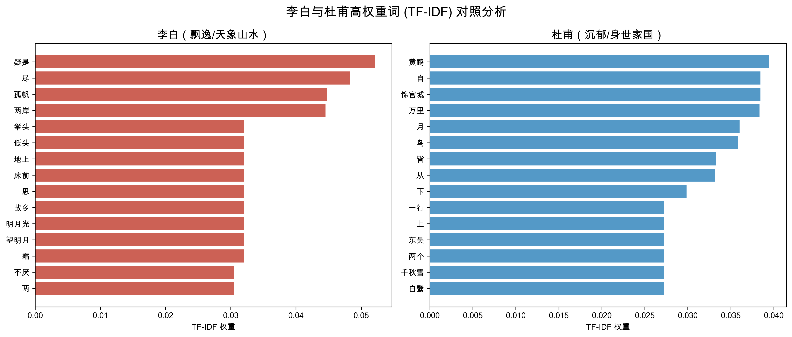

# 任务二：比较两位作者的文本特征（李白 vs 杜甫）

## 一、 分词与语料说明
- **语料选择与控制**：选取李白与杜甫各 10 首短篇诗歌。为尽量控制体裁与文本长度差异，李白选取其代表性的五绝、七绝（单篇 20-28 字）；杜甫选取其五律、七律及部分绝句（单篇 28-56 字），排除了长篇歌行对词频的稀释影响。
- **分词与停用词规则**：使用 `jieba` 分词，并加入自定义诗词词典（如“孤帆”“锦官城”等）防止专有名词被切碎。停用词采用两层过滤：过滤标点符号及“之、其、而、以”等文言虚词；**未过滤**“白”“独”“两”等具有实词意义的字词，以便观察意象分布。

## 二、 分析设置与结果（对照图）
- **分析设置**：使用 `sklearn` 的 `TfidfVectorizer`。针对古诗词短文本特征，启用了 `sublinear_tf=True`（对数平滑）防止单次出现的词权重过低，同时允许 `ngram_range=(1,2)` 以捕获单字与双字词。提取两位作者各自 TF-IDF 均值 Top 15 作为高权重词。
- **对照图**：

## 三、 主题 / 关键词表
*基于 TF-IDF 提取的实测结果*

| 作者 | 前 15 高权重词 | 核心主题归纳 |
| :--- | :--- | :--- |
| **李白** | 疑是, 尽, 孤帆, 两岸, 举头, 低头, 地上, 床前, 思, 故乡, 明月光, 望明月, 霜, 不厌, 两 | **天象空间与思乡**（以明月、孤帆、霜为主要意象） |
| **杜甫** | 黄鹂, 白, 锦官城, 万里, 月, 鸟, 皆, 从, 下, 一行, 上, 东吴, 两个, 千秋雪, 白鹭 | **地理时序与物候**（受单篇绝句影响，集中于动植物与广阔地理词） |

## 四、 原文核查记录（抽查）

- **李白组抽查：**
  - **高频词“疑是”“举头”“低头”**：核对原文，这三个词均来自《静夜思》。因该诗极短，导致动作词和推测词占据极高权重。这说明**短文本的 TF-IDF 极易被单篇名作“绑架”**。
  - **高频词“孤帆”**：核对《黄鹤楼送孟浩然之广陵》“孤帆远影碧空尽”，此处“孤帆”搭配“碧空”“远影”，指向开阔、空灵的视觉空间感，而非凄苦。
- **杜甫组抽查：**
  - **高频词“黄鹂”“白鹭”“两个”“一行”**：核对原文，这些词全部密集出现在《绝句·两个黄鹂鸣翠柳》中。虽构建了明丽对仗，但在统计上暴露出单篇文本组合词的严重干扰。
  - **高频词“白”**：核对《春望》“白头搔更短”与《登高》“渚清沙白鸟飞回”。李白的“白”多为自然光色，而杜甫的“白”多与“头（衰老）”、“沙（苍凉）”结合，带有沉重的时间与身世感。

## 五、 解释克制（约 150 字）

> 基于 TF-IDF 词频与原文核查，李白组的高权重词更偏向**天象与空间感**（如明月光、孤帆、两岸），杜甫组更偏向**具体物候与地理**（如黄鹂、锦官城、万里）。**这能支持**：两组文本在表层词汇的意象选择上确实存在客观差异，侧面印证了“飘逸 vs 沉郁”的宏观文学印象。**但这不能证明**：其一，算法不懂语义，如两人同用“白”字，情感底色截然不同；其二，受限于 10 首短文本样本，统计结果被单篇名作严重干扰（如杜甫的《绝句》包揽了 6 个高频词），因此绝不能将此词频差异直接等同于两人全部创作的艺术成就或真实心理。